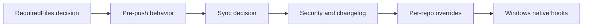
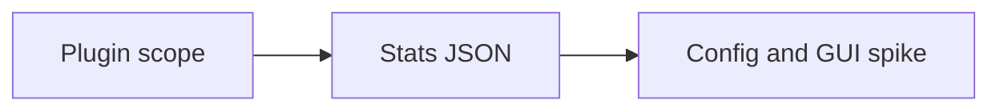

# git-policy Roadmap

Last updated: 2026-11-24

## Current status

- Version: `v1.1.0` is the latest release (2026-07-30), preceded by `v1.0.1` (2026-07-16) and `v1.0.0` (2026-07-03). Baseline for this session was a clean tree at `1dfb815` (`docs: update ROADMAP.md...`).
- Quality gates: `make lint`, `make vet`, `make test`, `make build`, and the CI-form coverage command all exited `0` on 2026-11-24. `gh run list --limit 10` returned 10/10 success, including release run `30564856094` on `v1.1.0` and test run `30564832509` on `main`.
- Coverage: `CONTRIBUTING.md:269` requires 90%+ for `internal/` packages. Measured misses include `internal/runner` 19.0%, `internal/config` 46.5%, `internal/plugins` 0.0%, `internal/sync` 0.0%, `internal/git` 67.8%, `internal/history` 70.5%, `internal/hook` 71.1%, `internal/utils` 75.0%, and `internal/engine` 80.0%. The target is not lowered.
- Issues: `gh issue list --state open --limit 100` and the closed-issue check both returned `[]`. No GitHub issue numbers exist to reference; every queue item is marked `needs-issue`.
- Board: `git-policy Roadmap` project 25 at https://github.com/users/marcuwynu23/projects/25 holds 12 draft items; 11 `Todo` and 1 `Done` after the docs-drift item closed, with no issue numbers.
- Documentation drift was resolved 2026-11-24 in `README.md`, `CONTRIBUTING.md`, `CHANGELOG.md`, and prior roadmap wording; `SECURITY.md` remains an unfilled template (see Risks).

## Implemented features

| Feature | Status | Evidence |
| --- | --- | --- |
| Cobra CLI with `rule` and `policy` aliases | done | `main.go:5`, `cmd/root.go:12-35`, `cmd/policy.go`, `cmd/cmd_test.go` |
| Global Git hook install/uninstall with static builds | done | `internal/hook/hook.go`, `internal/hook/hook_test.go`, `Makefile:9,17` |
| Six built-in policies | done | `internal/policy/*.go`, `internal/runner/runner.go:40-45`, `internal/policy/policy_test.go` |
| Custom YAML rules (file-block, file-content, branch-name, commit-message) | done | `internal/policy/custom.go`, `internal/policy/custom_test.go`, `USER-GUIDE.md:384-489` |
| Plugin CLI: install, list, uninstall, enable/disable | done | `cmd/policy.go`, `cmd/cmd_test.go` (`TestPlugins*`) |
| Persistent rule skip list and clear/list commands | done | `internal/runner/runner.go:103-120`, `internal/engine/engine_test.go`, `cmd/cmd_test.go` |
| Rule add/remove/import/export | done | `cmd/policy.go`, `cmd/cmd_test.go` |
| History query and clear | done | `cmd/history.go`, `internal/history/history.go`, `internal/history/history_test.go` |
| Conventional commit-message validation | done | `internal/policy/commitmsg.go`, `internal/policy/policy_test.go` |
| Staged-file secret scanning and block-file policy | done | `internal/policy/secret.go`, `internal/secrets/secrets.go`, `internal/policy/policy_test.go` |
| Three-OS CI matrix with lint, vet, tests, coverage | done | `.github/workflows/test.yml:10-60` |
| Tagged cross-build release workflow | done | `.github/workflows/release.yml:4-50`, release `v1.1.0` |
| v1.1.0 release notes | done | `docs/releases/v1.1.0/RELEASE-NOTES.md` |

## Not done / none

- No P0 security or data-loss fix is currently identified: no open issues exist and all quality gates are green. If one appears, it supersedes this queue.
- Remote policy sync is not done: `cmd/sync.go:17` prints `Sync command is not yet implemented.` and `internal/sync/sync.go` has no tests.
- Config v2 migration is not done and remains explicitly out of scope.
- GUI, VS Code, and JetBrains adapters are not done and remain out of scope.
- RequiredFiles policy is not done: `internal/config/config.go:67,247` defines `RequiredFiles` with defaults `README.md` and `LICENSE`, but no policy is registered in `internal/runner/runner.go:40-45`.
- Windows native hooks are not done: current install path still depends on Git Bash per user documentation.

## Roadmap verdicts

| Prior roadmap item(s) | Verdict | Evidence / note |
| --- | --- | --- |
| v1.0 core setup, CLI, global hooks, six policies, custom rules, plugin CLI, skip list, rule management, history, CI, releases | done | See Implemented features; retain as history, not future work |
| v1.0 "current release" label | done | Stale label removed from `ROADMAP.md`; `gh release list` shows `v1.1.0` latest on 2026-07-30 |
| v1.0 docs accuracy for Go version, plugin support, release tooling | done | `README.md:7,225-227`, `CONTRIBUTING.md:18,284-301`, `CHANGELOG.md:7-25` reconciled 2026-11-24; `SECURITY.md` remains open |
| v1.0 90%+ coverage target | at risk | `CONTRIBUTING.md:269` vs measured 0.0%-80.0% misses above |
| v2 remote sync | at risk | `cmd/sync.go:17` placeholder; `internal/sync` 0.0% coverage |
| v2 plugin enhancements | at risk | Existing plugin CLI has no scoped enhancement and `internal/plugins` 0.0% coverage |
| v2 per-repo overrides | at risk | Prior item unchecked; no precedence tests found |
| v2 pre-push checks | at risk | `hooks/pre-push` installs a shim, but no push-specific rules exist |
| v2 required-files policy | at risk | Config field exists without registered policy or tests |
| v2 Windows native hooks | at risk | Native path absent; Git Bash requirement remains in docs |
| v2 observability / `stats --json` | at risk | `internal/history` exists, but no stats command was found |
| v2 config v2 migration | stale | Prior item unchecked and explicitly out of scope; needs decision |
| v2 GUI/VS Code/JetBrains adapters | stale | Prior item unchecked and explicitly out of scope; needs decision |

## Research: comparable projects

All URLs below were fetched on 2026-11-24. No link is inferred from memory.

| Source | Useful pattern | Decision | Why |
| --- | --- | --- | --- |
| https://typicode.github.io/husky/ | `core.hooksPath`, 2 kB footprint, all 13 Git hooks, `HUSKY=0` global opt-out | adapt | `git-policy` already uses hook paths; an explicit escape hatch could improve the persisted skip UX |
| https://github.com/typicode/husky/releases | Frequent small releases with visible notes and contributor credit | adopt | Keep release notes current; `CHANGELOG.md:7-25` now records v1.0.1 and v1.1.0 |
| https://github.com/evilmartians/lefthook | Single Go binary, `AGENTS.md`, codecov, `goreleaser`, integration tests | adopt/adapt | Static Go builds already match; add coverage posture; goreleaser documentation reconciled with the actual workflow in `CONTRIBUTING.md:284-301` |
| https://pre-commit.com/ | `SKIP` env var, `validate-config`, `try-repo`, declared hook types | adapt | Rule skip persists to config; an ephemeral bypass and config dry-run are worth scoping |
| https://github.com/gitleaks/gitleaks | Allowlists, baseline, `git`/`dir`/`stdin` scan modes, feature-complete governance | adapt | Existing secret scan covers staged files; history scanning or allowlists are possible scoped enhancements |

## Prioritized execution queue

Priorities: P0 = security/data-loss blocker, P1 = production readiness, P2 = meaningful capability gap, P3 = exploratory. Effort: S = hours, M = days, L = weeks, XL = multi-week/spike.

### Now (P1)

1. **Reconcile docs with shipped behavior** — done 2026-11-24, S, P1 (was `needs-issue`). Closed Go version, plugin support, release tooling, and current-release drift in `README.md:7,225-227`, `CONTRIBUTING.md:18,284-301`, `CHANGELOG.md:7-25`, and prior roadmap wording; `SECURITY.md` remains in the P2 docs item. Board status moved to `Done`.
2. **Close internal coverage gap to documented 90%+** — `needs-issue`, L, P1. Evidence in Current status; do not lower `CONTRIBUTING.md:269`.
3. **Normalize Go formatting across 21 files** — `needs-issue`, S, P1. Evidence: `gofmt -l .` listed 21 files; `.golangci.yml` does not enable `gofmt`, so lint passes despite sampled missing final newlines.

### Next (P2)

1. **Define RequiredFiles policy behavior** — `needs-issue`, M, P2. Implement with pass/fail/edge tests and docs, or remove dead config with a migration note.
2. **Make pre-push checks actionable** — `needs-issue`, M, P2. Document the no-op shim or add a tested push-stage rule.
3. **Wire sync command or retire it** — `needs-issue`, M, P2. `cmd/sync.go:17` and `internal/sync/sync.go` need a decision.
4. **Refresh SECURITY.md and CHANGELOG.md** — `needs-issue`, S, P2. Supported versions must match v1.x; v1.1.0 must be recorded.
5. **Add per-repo config overrides** — `needs-issue`, L, P2. Define precedence, tests, and USER-GUIDE documentation.
6. **Support Windows native hooks** — `needs-issue`, L, P2. Verify native install/uninstall on `windows-latest`.

### Later (P2/P3)

1. **Scope plugin enhancements** — `needs-issue`, M, P3. Existing plugin CLI needs a concrete enhancement and coverage.
2. **Add observability stats and JSON output** — `needs-issue`, M, P3. Build on `internal/history` with `stats --json`.
3. **Decide config v2 migration and GUI adapters** — `needs-issue`, XL, P3. Written spike decision required before implementation.

## Issue triage

- `gh issue list --state open --limit 100 --json number,title,labels,milestone,updatedAt` returned `[]`.
- Closed-issue check also returned `[]`; there are no issue numbers, labels, or milestones to sync.
- Verdict: no open issues to triage, rank, close, or link. All queue items are board draft issues marked `needs-issue`; no issue numbers have been invented.
- `gh label list` returned only default labels (`bug`, `documentation`, `duplicate`, `enhancement`, `good first issue`, `help wanted`, `invalid`, `question`, `wontfix`). No custom triage labels were found.

## GitHub Projects

- Before action: `gh project list --owner marcuwynu23 --limit 100` showed projects 24, 20, 19, and 18; repository-linked `projectsV2` nodes were `[]`.
- Created: `git-policy Roadmap`, project 25, private, owner `marcuwynu23`, id `PVT_kwHOA7B5Z84Bs58E`, URL https://github.com/users/marcuwynu23/projects/25.
- Metadata: short description "Evidence-based roadmap and delivery queue for git-policy, a global Git rule management CLI."; project README links to `README.md`, `USER-GUIDE.md`, `ROADMAP.md`, and names selected repository `marcuwynu23/git-policy`.
- Fields: `Status` (`Todo`, `In Progress`, `Done`), `Priority` (`P0`, `P1`, `P2`, `P3`), `Effort` (`S`, `M`, `L`, `XL`).
- Synced items: 12 draft issues; 11 `Todo` and 1 `Done` (docs-drift item closed), matching the 3 Now + 6 Next + 3 Later queue above. No real issue links are present.
- Repository association: GitHub does not allow setting the native `Repository` field on draft issues (`updateProjectV2ItemFieldValue` returns "field of type repository is currently not supported"); all 12 item bodies now include `Repository: marcuwynu23/git-policy`. Creating real issues is required to populate the native field.
- Verification: `gh project item-list 25 --owner marcuwynu23 --limit 30 --format json` returned `totalCount: 12` with expected `priority`, `effort`, `status`, and repository lines.

## Ownership and cadence

- Roadmap and board owner: project manager agent workflow; maintainer `marcuwynu23` remains approver for scope, priority, and GitHub writes.
- Review cadence: after each merge or release, and monthly. Next scheduled review: 2026-12-24, or earlier when the Now bucket closes.
- Definition of done for a roadmap item: stated code/docs/tests landed, `make lint`, `make vet`, `make test`, `make build`, and CI-form coverage pass; board item moved to `Done`; a real GitHub issue link recorded or the `needs-issue` status explicitly resolved.

## Risks / open questions

- Documentation drift was resolved 2026-11-24; `SECURITY.md` remains an unfilled template and belongs to the P2 docs item.
- The 90%+ `internal/` coverage target is unmet in several packages; report numbers rather than weakening the gate.
- No GitHub issues exist, so board items are provisional `needs-issue` drafts until issues are explicitly created.
- `gofmt -l .` lists 21 files while lint passes; decide whether to normalize or document an exception.
- Release cadence gap: latest release 2026-07-30, roughly four months before this review; `CHANGELOG.md` is now current.
- No P0 item is present today; a security or data-loss finding would immediately supersede this queue.
